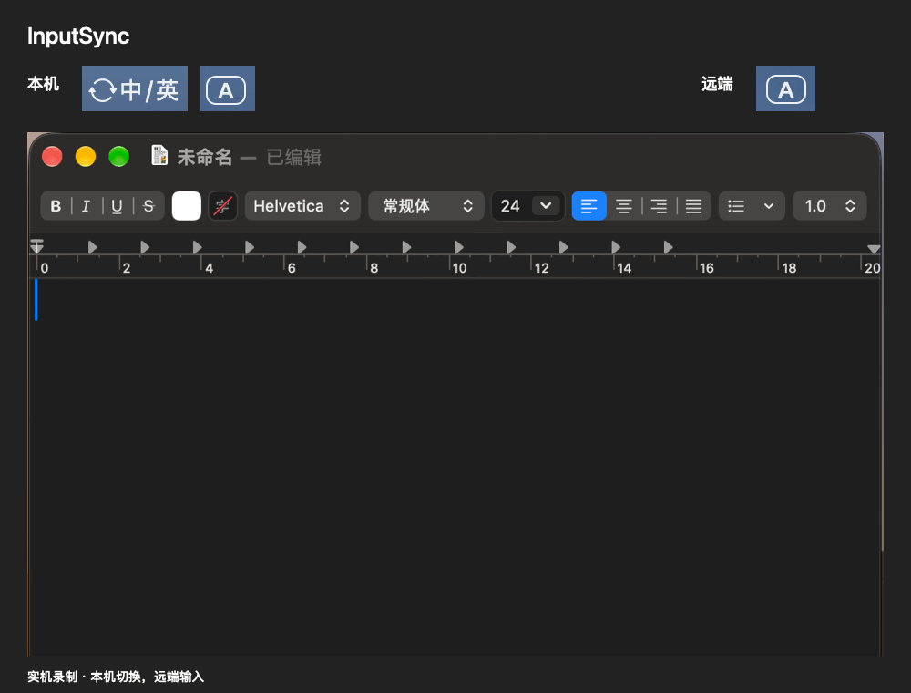

[简体中文](../README.md) · [English](../docs/README.en.md) · [繁體中文](../docs/README.zh-Hant.md) · [日本語](../docs/README.ja.md) · [한국어](../docs/README.ko.md) · [Deutsch](../docs/README.de.md) · [Français](../docs/README.fr.md) · [Español](../docs/README.es.md)

# InputSync

A Mac menu bar app that syncs the remote input source with your local Mac in Screen Sharing. **Install locally only**; no remote setup needed.

## Get started

1. Download the latest `.dmg` from this project’s [GitHub Releases](https://github.com/94cp/InputSync/releases/latest). Open it, drag **InputSync** into **Applications**, then open the app from Applications. No Xcode or compilation is needed.
2. Grant the app access through its permission-settings action. Depending on macOS, the permission is called **Accessibility** or **Device Control and Data Access**.
3. Connect to the remote Mac using Apple Screen Sharing.
4. In InputSync, enable keyboard language sync. You can also enable it in Screen Sharing’s **Edit → Sync Keyboard Language** menu on the local Mac.
5. Enable sync in InputSync. Switch your local input source as usual, wait about a second, then type remotely.

Each launch starts paused, including launches at login. A remote menu may briefly appear during synchronization.

### First launch: macOS blocks the app

This build is not signed with an Apple Developer ID or notarized. macOS may say it cannot verify the developer or check the app for malicious software.

If you downloaded it from this project’s [GitHub Releases](https://github.com/94cp/InputSync/releases/latest):

1. Open InputSync from **Applications** once. If blocked, dismiss the alert without moving the app to Trash.
2. Open **System Settings → Privacy & Security**, then scroll to **Security**.
3. Find the message about InputSync and click **Open Anyway**.
4. Authenticate with your Mac login password or Touch ID if prompted, then click **Open** in the confirmation dialog.

If **Open Anyway** is missing, try opening the app again, then return to Settings. Once launched, look for InputSync in the menu bar; it does not open a main window. Next, grant the app its requested Accessibility permission—allowing it to open does not grant that permission.

## Updates

Choose **Check for Updates…** from the menu. Toggle automatic checks under **More**. Confirm an update to download, install and restart. Version 0.7.0 needs one manual upgrade.

## How it works

Apple Screen Sharing’s keyboard-language sync can update the remote input-source indicator while the active app still uses the previous input mode. In our tests, briefly opening and closing a remote menu made the change take effect. InputSync automates that workaround.

1. Observe macOS notifications when the local input source changes, regardless of the key or shortcut used.
2. Wait for the configured delay (0.5 seconds by default), allowing Screen Sharing to synchronize the language.
3. Locate the shared screen in the active window through Accessibility, click near the remote menu bar’s upper-left corner, then send Escape to close the menu.

This is an experimentally verified UI workaround, not a remote input-method API. It relies on the remote menu bar being reachable at the expected location. A brief menu flash is part of the mechanism.

Resizing or moving the window is supported. If it changes during a pending refresh, that refresh is skipped; switch input sources again after adjusting it. Full-screen and scaling combinations have not all been tested.

## Menu bar symbol and language

Under **More**, choose the menu bar symbol. **Automatic** uses recognizable keyboard layout information, then the macOS region:

- China mainland, Taiwan, Hong Kong, Macao: **中/英**
- Japan: **英数 / かな**
- South Korea: **한/영**
- Other regions: globe

This is a suggested display, not a reliable reading of keycap labels. Manual choices take priority. The symbol does not remap keys or change input sources.

The interface follows the app language configured in macOS Language & Region settings. Eight languages are included; others fall back to English.

## Troubleshooting

- **Permission is enabled but unavailable:** toggle this app’s permission off and on, then restart it. Updates may require authorization again.
- **No synchronization:** enable sync in both apps, keep the remote window active, and try a longer delay from the menu.
- **Logs:** open them from the More menu.

The workaround has been verified with ABC and system Simplified Pinyin on macOS 27.2. Other input methods and older macOS versions have not been fully tested. It targets Apple Screen Sharing, without a fixed Mac model or window size requirement.

## Uninstall

Disable Launch at Login, quit InputSync, and delete the app. Optionally delete the log: `~/Library/Logs/InputSync/events.log`.

## Support development

If InputSync helps you, buy me a coffee. A Star on GitHub is also appreciated!

| WeChat Pay | Alipay |
| :---: | :---: |
|  |  |

[Development](DEVELOPMENT.md)

## License

Licensed under the [MIT License](../LICENSE).
